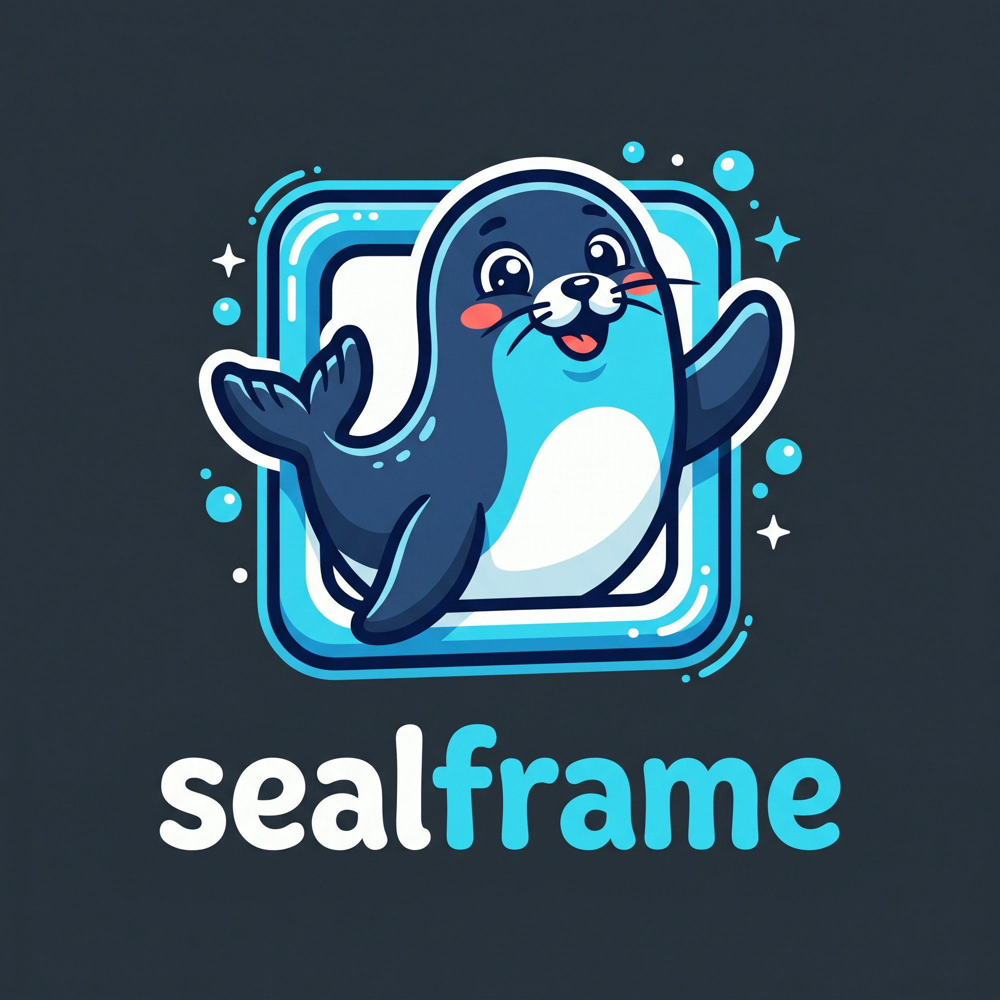

<p align="center">
  
</p>

<h1 align="center">SealFrame™ (<code>sf</code>) — v0.6.0</h1>

<p align="center">
  <strong>Crash-Safe Verified File/OTA Delivery &amp; Distributed AI WAN Acceleration — Pure C11 (POSIX/Linux).</strong>
</p>

<p align="center">
  <a href="https://github.com/tonythewizard/sealframe/actions/workflows/ci.yml"></a>
  <a href="LICENSE"></a>
  
  
</p>

---

### Why SealFrame™?

#### 1. Crash-Safe Atomic & Zero-Trust File / OTA Delivery
- **Crash-Safe Atomic Commits & Auto-Rollback (`SIGKILL`-Resilient):** Transactional commits across **Files + AI Models + SQLite WAL** (`flock` + `fsync` + atomic `rename` + persistent `.sf_tx_journal` + immutable sealed generations), exact Merkle chunk resume after abrupt shutdowns, and automatic health-watchdog rollback that bit-exact inverts both files and SQLite rows (`0` split-brain or corrupt states across 12 consecutive multi-boundary OS `SIGKILL` chaos tests).
- **Cryptographic Zero-Trust & Anti-Byzantine:** Every 16 KiB chunk is verified inline with **BLAKE3 Merkle proofs** (1-bit in-flight tamper or silent disk bit-rot rejected fail-closed), protected by **2-of-3 Ed25519 Root Multi-Sig** with monotonic revocation & target deactivation, Ed25519 device enrollment/pinning with replay protection, cryptographic 2-of-N approver quorum, over **1-RTT X25519 + XChaCha20-Poly1305** encrypted TCP/UDP (`FP-UDP1` survives **25% packet loss + live IP/NAT migration**; poisoned swarm peers are banned on the first bad chunk).
- **Extreme Efficiency & Tiny Footprint:** C11 (POSIX/Linux) — zero Python, zero C++, zero OpenSSL, zero `libcurl`; ~150–210 KB binaries, **5.86 MiB RSS** serving 512 MiB on 256 MiB RAM hardware, `-99.8%` FastCDC/delta patches (**22× faster & 147× fewer bytes** than `rsync`).

#### 2. Distributed Split-Model AI Inference over WAN (Drop-In)
- **`sf-llama-bridge`** transparently accelerates `llama.cpp` (`ggml-rpc`) across slow, lossy residential/cross-country links: **up to `-97.5%` wire reduction**, encrypted `FP-UDP1` + adaptive 0-RTT XOR FEC, outlier-safe wire codecs (`BF16`/`INT8*`/`INT4+Outlier`), sparse FP32 Top-K logits transport (exact for greedy / top-k ≤ K), and 0-RTT control pipelining.
- **6-Shard / 6-Country WAN-Emulated A/B (`570 ms` cumulative RTT):** **`4.2×`** serial speedup on `Qwen3.5-9B` (`0.33 → 1.38 tok/s`), up to **`10.4×–13.2×`** with a local coordinator draft on `Qwen3-8B` (**`2.73–3.45 tok/s`** median, peak **`9.41 tok/s`**), cutting per-request prompt overhead from `~55 s` down to **`3–5 s`**.

> **Dual-Licensed:** Open-source under **GNU AGPL-3.0** ([`LICENSE`](LICENSE)) and available under a **Commercial License** ([`LICENSE-COMMERCIAL.md`](LICENSE-COMMERCIAL.md)) for proprietary/OEM embedding, SaaS/cloud deployments, and EU CRA LTS support. Contact: **`tonyswagcard@gmail.com`**.

---

## Core Components

| Binary / Artifact | Purpose |
| :--- | :--- |
| **`bin/sf`** | Core CLI: BLAKE3 16 KiB Merkle DNA (`O(N / 16 KiB)` tree), Morph (`RAW`/`ZSTD`/`DELTA`/`REF`/`COMPUTE`), FastCDC streaming chunker (`O(1)` chunker RAM), `FPB1` atomic File+SQLite bundles, `FPR1` 2-of-3 TUF Root Multi-Sig, `FP-NET` TCP & `FP-UDP1` encrypted transport, anti-Byzantine Swarm. |
| **`bin/sf-agent`** | Hardened Edge OTA daemon (`systemd` ready): hybrid LAN `FP-NET` + HTTP/1.1 `206` Range resume, crash-recovery journal, health watchdog, automatic File + SQLite WAL rollback (`sqlite3changeset_invert`), physical revoke deactivation, monotonic Ed25519 heartbeats. |
| **`bin/sf-cp`** | Pure-C11 On-Prem Control Plane (~4 MiB RSS): Ed25519 device enrollment/key-pinning + anti-replay telemetry, cryptographic 2-of-N Ed25519 approval quorum enforcement, monotonic rollout/rollback, EU CRA JSON/HTML audit endpoints. |
| **`bin/sf-llama-bridge`** | Transparent `llama.cpp` (`ggml-rpc`) WAN accelerator: `FP-UDP1` + Adaptive 0-RTT XOR FEC, `SFT1` wire quantization (`BF16`/`FP16`/outlier-safe `INT8`/`INT4+Outlier`), batched sparse FP32 Top-K logits, BLAKE3 DNA dedup, Zstd + zero-block compression, 0-RTT void-command pipelining, and pointer-independent `GET_ALLOC_SIZE` cache. |
| **`libsealframe.a` / `.so`** | C11 SDK (`sealframe.h`, `sealframe_agent.h`, `sealframe_split.h`, `sealframe_chain.h`) + multi-chain anchoring adapters (Generic JSON-RPC 2.0, EVM Keccak-256/ABI, Solana Anchor/Borsh, Keryx OPoI Phase-2 + RFC 6455 WebSocket). |

---

## 60-Second Quickstart

```bash
# 1. Build all 4 pure-C11 binaries + libsealframe.a/.so (vendored BLAKE3 by default)
make

# 2. Run all 11 pure-C11 test suites (including SIGKILL chaos, 25% UDP loss, Byzantine swarm,
#    Edge Agent, 4 blockchain adapters, Split-Model shim, and Red-Team torture suite)
make test
make examples

# 3. Verify ELF security hardening (PIE + Full RELRO + NX + Canary), CycloneDX 1.5 SBOM, and .deb package
make security-check
make sbom
make deb

# 4. Run multi-profile sf-llama-bridge selftest (248k vocab Top-K, SSM/MoE lossless guards, FP-UDP1 + FEC)
./bin/sf-llama-bridge --selftest --transport udp --cast int8 --fec auto --logits-topk 64 --drop 2

# 5. End-to-end B2B demo (2-of-3 Multi-Sig, rogue attack rejection, auto-rollback, CRA Audit)
bash scripts/demo_cto.sh

# 6. Sanitizers (GCC ASan + UBSan) & Clang coverage-guided libFuzzer
make test-asan
make libfuzzer FUZZ_SECS=15

# 7. System installation (/usr/local/bin/{sf,sf-agent,sf-cp,sf-llama-bridge}, libsealframe, headers)
sudo make install
```

### C11 & Python Quickstarts
- C11 (`pkg-config --cflags --libs libsealframe`): [`examples/c_quickstart.c`](examples/c_quickstart.c) · [`examples/llama_split_shim_demo.c`](examples/llama_split_shim_demo.c)
- Zero-dependency Python (`ctypes`): [`examples/py_quickstart.py`](examples/py_quickstart.py) · [`bindings/python/sealframe.py`](bindings/python/sealframe.py)

---

## Measured Results (`v0.6.0`, `-O3`, GCC & Clang `-Werror -pedantic`)

### 1. Physical Hardware & Storage / Transport (Measured on Real LAN)
- **Constrained hardware streaming (Proxmox LXC, Pentium P6100, 256 MiB RAM, mechanical HDD):** serves **512 MiB** (`2×` RAM) via `pread()` at **29.8 MiB/s** with **5.86 MiB Peak RSS**; `SIGKILL` at 134 MiB resumes bit-exact (`8,529` chunks skipped).
- **Delta & FastCDC:** 4 KiB patch in 32 MiB file = **56.5 KiB** (`-99.83%`); +137 B shift dedup = **99.88%** in `42 ms`; No-Op 32 MiB = **22× faster & 147× fewer bytes** than `rsync --checksum`.
- **Encrypted `FP-NET` TCP & `FP-UDP1`:** X25519 + Ed25519 + XChaCha20-Poly1305 AEAD; **29.7 MiB/s** on physical LAN; `FP-UDP1` survives **25% packet loss + live IP/port migration**; Byzantine swarm peer banned deterministically on the first corrupted chunk.
- **Atomic File + SQLite WAL Rollback:** verified under real `SIGKILL` and `--health-cmd` failure with bit-exact SQLite state inversion (`sqlite3changeset_invert`).
- **Fuzzing & Red-Team:** **>10M executions** with Clang `libFuzzer + ASan + UBSan` across all 8 binary parsers (`FP01`/`FPE1`/`FPD1`/`FPB1`/`FPR1`/`FPC1`/Merkle/`SFT1`) → **0 crashes, 0 UB, 0 leaks**; 0 findings in `test_redteam.c`.

### 2. Distributed Split-Model WAN Acceleration (`sf-llama-bridge`, Emulated 6-Country WAN)
Measured on **1 physical host** running **6 real `llama.cpp` `ggml-rpc-server` shards** fronted by per-hop WAN shaping modeling 6 residential/intercontinental links (`DE 28 ms`, `UK 42 ms`, `PL 55 ms`, `US-East 105 ms`, `US-West 155 ms`, `SG 185 ms + P99@6%`; cumulative RTT = **`570 ms`**, `8–20 Mbps` UL, `0.5–2.0%` loss; N=5 requests, `temp=0`, `cache_prompt=false`):

- **`Qwen3.5-9B Q5_K_M` (no draft, 6 shards):** Stock TCP `0.329 tok/s` (`3,038 ms/tok`) → **SealFrame `1.383 tok/s`** (`723 ms/tok`, **`4.20×`**), end-to-end `0.161 → 0.586 tok/s` (`3.64×`), wire `-79.8%` (`-89.4%` TX).
- **`Qwen3-8B Q4_K_M` (pure Transformer, 6 shards = 6 layers/country):**
  - Stock TCP (no draft): **`0.262 tok/s`** (`0.61 tok/s` prompt, `851 s` load, `1,063 MB` wire).
  - SealFrame v4 `BF16` (no draft): **`1.501 tok/s`** (**`5.73×`**, `6.59 tok/s` prompt, `90.7 s` load, `-93.1%` wire, `4/5` exact match).
  - SealFrame v4 `INT8*` (outlier-safe) + local `Qwen3-1.7B` draft (`K=10`): **`2.730 tok/s` median** (`1.81..5.44`, **`10.42×`**, `4/5` exact match).
  - SealFrame v4 `INT4+Outlier` + local `Qwen3-1.7B` draft (`K=12`): **`3.447 tok/s` median** (`2.42..9.41`, **`3.96 tok/s`** on 64-tok cut, **`13.16×`**, `9.56 tok/s` prompt, `31.6 MB` wire = **`-97.5%`**).

*(Note: 6-country figures above are single-host WAN-shaped A/B benchmarks, separate from live multi-host internet testing. See [`integrations/llama_cpp/README.md`](integrations/llama_cpp/README.md) and the reproducible scripts in `integrations/llama_cpp/`.)*

---

## Documentation & Compliance
- Wire & storage format specification: [`SPEC.md`](SPEC.md)
- `llama.cpp` split-model WAN bridge guide: [`integrations/llama_cpp/README.md`](integrations/llama_cpp/README.md)
- EU Cyber Resilience Act (CRA) Technical File, DoC, CVD & Integrator Manual: [`docs/`](docs/)
- Physical 2-host Proxmox test report & guide: [`docs/PHYSICAL_TEST_REPORT_v0.2.md`](docs/PHYSICAL_TEST_REPORT_v0.2.md) · [`PHYSICAL_TEST_GUIDE.md`](PHYSICAL_TEST_GUIDE.md)
- Smart contracts (EVM & Solana): [`contracts/`](contracts/)

---

## Licensing, Trademarks & Security
- **Open-Source License:** GNU Affero General Public License v3.0 — [`LICENSE`](LICENSE)
- **Commercial License (OEM / Proprietary / SaaS / CRA LTS):** [`LICENSE-COMMERCIAL.md`](LICENSE-COMMERCIAL.md) — contact **`tonyswagcard@gmail.com`**
- **Trademark Policy:** [`TRADEMARKS.md`](TRADEMARKS.md)
- **Third-Party Notices:** [`NOTICE`](NOTICE)
- **Security & Vulnerability Disclosure:** [`SECURITY.md`](SECURITY.md)
- **Contributing & Dual-License CLA:** [`CONTRIBUTING.md`](CONTRIBUTING.md)
